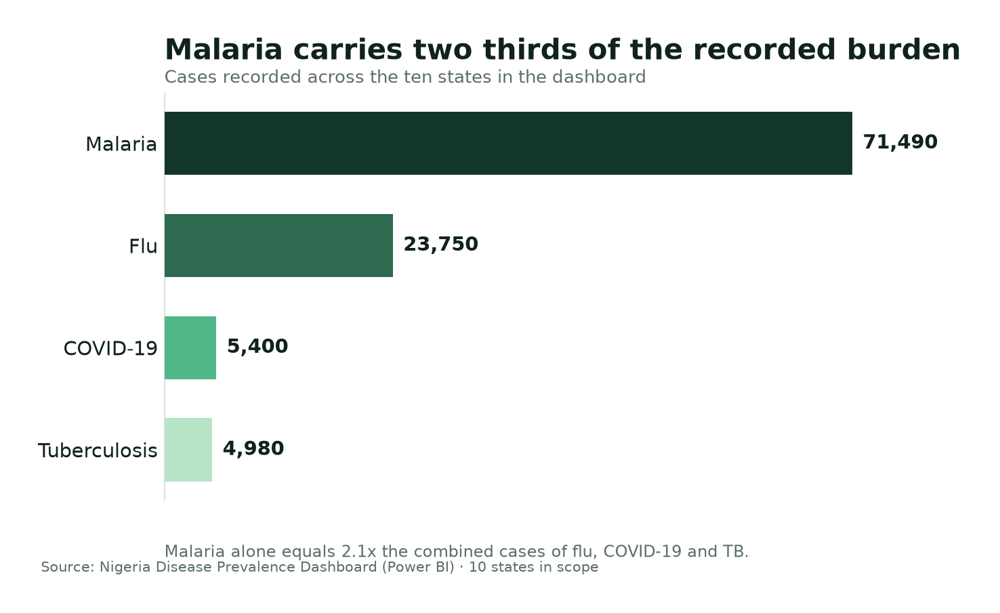
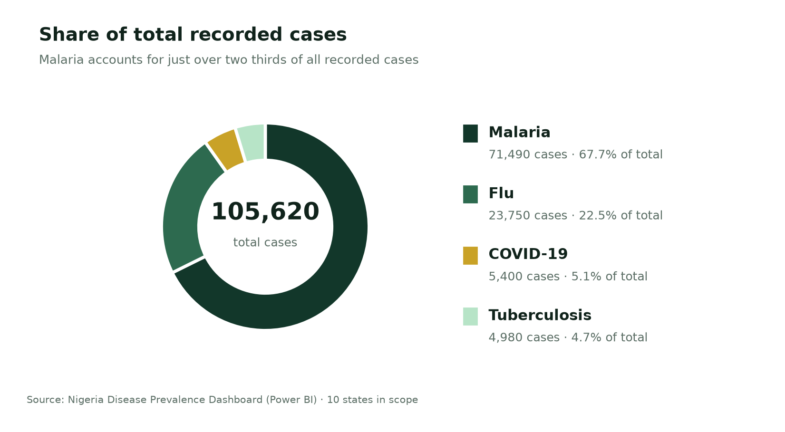
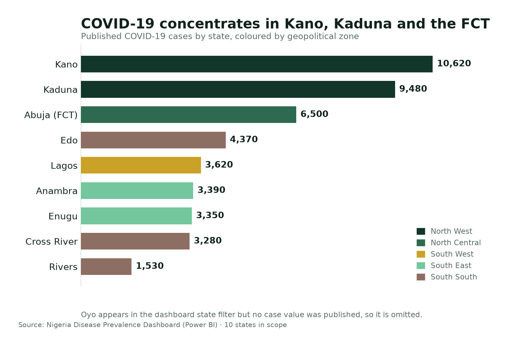
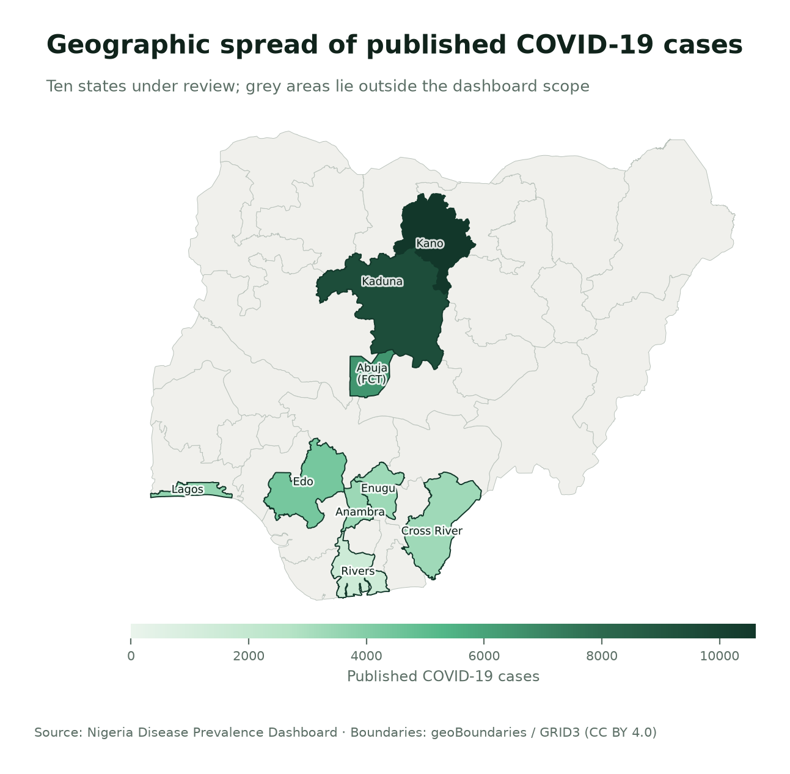
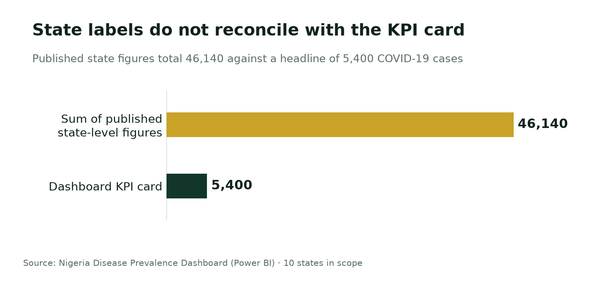
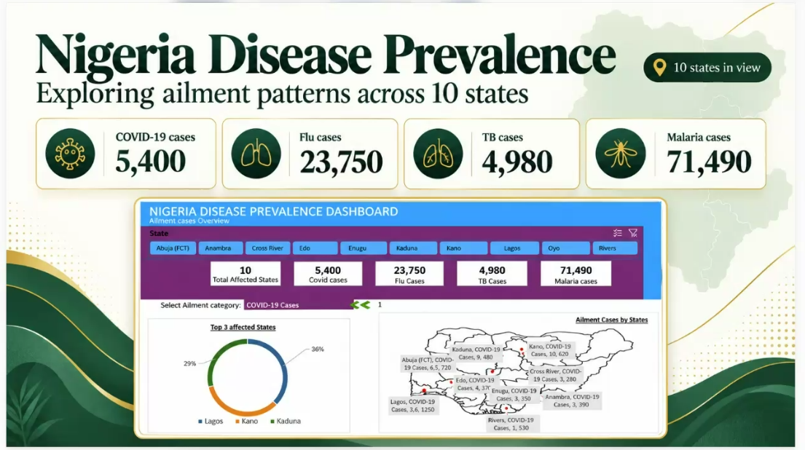

<div align="center">

# Nigeria Disease Prevalence Dashboard

**Malaria, flu, COVID-19 and tuberculosis across ten Nigerian states — the published Power BI
dashboard, a curated dataset, and a fully reproducible analysis.**


[The report](docs/report.md) · [Data notes](docs/data_notes.md) · [Dataset](data) · [Original article](https://medium.com/@krisnice2002gmail.com/nigeria-disease-prevalence-dashboard-key-insights-from-10-states-c622920f527a)

</div>

---

## At a glance

| Disease | Cases | Share of recorded cases |
| :--- | ---: | ---: |
| **Malaria** | **71,490** | 67.7% |
| Flu | 23,750 | 22.5% |
| COVID-19 | 5,400 | 5.1% |
| Tuberculosis | 4,980 | 4.7% |
| **Total** | **105,620** | 100% |

*Scope: ten states — Abuja (FCT), Anambra, Cross River, Edo, Enugu, Kaduna, Kano, Lagos, Oyo and
Rivers. Not a national total.*

---

## Why this repository exists

A Power BI dashboard published in October 2026 showed how disease burden is distributed across ten
Nigerian states. That dashboard is a picture — useful, but hard to reuse, test or extend.

This repository turns it into something durable:

- a **curated dataset** in plain CSV, with a column that records where every number came from;
- a **reproducible analysis** that recomputes all headline metrics from those files;
- **publication-quality figures**, including a real geographic choropleth built on official state
  boundaries;
- **honest documentation** of the places where the source narrative and the source visualization
  disagree, instead of silently picking one.

The goal is simple: anyone should be able to clone this, run two commands, and get the same charts
and the same numbers.

---

## Key findings

### 1. Malaria carries two thirds of the recorded burden

Malaria accounts for **71,490 of 105,620 recorded cases (67.7%)** — roughly **2.1× the combined
burden of flu, COVID-19 and tuberculosis**. Any conversation about disease prioritisation in these
states has to start there.



### 2. The remaining three diseases form a long tail

Flu is the second-largest category at 23,750 cases (22.5%). COVID-19 (5,400) and tuberculosis
(4,980) together account for under 10% of recorded cases in this snapshot — small shares by volume,
but each carries its own surveillance and funding obligations.



### 3. COVID-19 is geographically concentrated

Of the state values published in the dashboard, the heaviest concentrations are **Kano (10,620)**,
**Kaduna (9,480)** and **Abuja, FCT (6,500)**. The two North West states alone carry **43.6%** of all
published state-level values, while **Rivers (1,530)** reports the lowest.



### 4. Geography, not summary statistics, is what drives action

The dashboard's map view is its most decision-relevant element. Turning it into a proper choropleth
makes the pattern unmissable: a northern cluster of high counts, coastal and south-eastern states far
behind, and everything else outside the review's scope.



### 5. Uneven distribution argues against one-size-fits-all funding

Because the burden is so unevenly spread, allocating surveillance capacity, test kits, medicines and
awareness budgets by state — rather than by national average — is the defensible strategy. That is
the central recommendation of the original report, and the data here supports it.

---

## Read this before quoting a number

The published dashboard has an internal inconsistency, and it matters.

The COVID-19 KPI card reports **5,400 cases**, yet the state-level figures add up to **46,140**.
Kaduna appears as 4,980 in the article prose and 9,480 on the map; Kano (the largest single value)
is absent from the prose entirely; Oyo has no published value at all.



This repository therefore uses the KPI card for the **disease-burden totals** and the state values
only for **ranking and geography**. Every affected row carries a `source` and `confidence` field, and
the full reconciliation is documented in **[docs/data_notes.md](docs/data_notes.md)**.

---

## The original dashboard

The analysis is derived from this Power BI report, reproduced unmodified from the published article.



<sub>Source: *Nigeria Disease Prevalence Dashboard*, Christian Iyayi, October 2026.</sub>

---

## Dataset

Two tidy CSVs, no external downloads and no API keys required.

```text
data/
├── disease_totals.csv     # case counts for the four diseases in scope
└── covid19_by_state.csv   # state-level COVID-19 values, with provenance
```

### `data/disease_totals.csv`

| Column | Type | Description |
| :--- | :--- | :--- |
| `disease` | text | Disease name as labelled on the dashboard |
| `cases` | integer | Cases recorded across the ten states in scope |

### `data/covid19_by_state.csv`

| Column | Type | Description |
| :--- | :--- | :--- |
| `state` | text | State name, normalised to the geoBoundaries spelling via an alias map |
| `geopolitical_zone` | text | One of Nigeria's six geopolitical zones |
| `cases` | integer or empty | Published cases; empty where the source is silent |
| `source` | text | `Article narrative`, `Dashboard map label`, `… + dashboard map`, or `Not reported` |
| `confidence` | text | `High`, `Medium` or `Low` — how directly the figure could be verified |
| `note` | text | Free-text caveat attached to the row |

```python
import pandas as pd

totals = pd.read_csv("data/disease_totals.csv")
states = pd.read_csv("data/covid19_by_state.csv")

print(totals["cases"].sum())          # 105620
print(states.sort_values("cases", ascending=False).head(3))
```

---

## Reproduce everything

```bash
git clone https://github.com/Christian-Iyayi/nigeria-disease-prevalence-dashboard.git
cd nigeria-disease-prevalence-dashboard

python -m venv .venv && source .venv/bin/activate
pip install -r requirements.txt

python src/analysis.py     # metrics -> outputs/metrics.json + metrics.md
python src/figures.py      # figures -> assets/figures/
```

Generated metrics land in [`outputs/metrics.md`](outputs/metrics.md). The figures are rebuilt from
the CSVs, so editing `data/*.csv` and re-running the scripts updates every chart.

Validate the dataset without plotting anything:

```bash
python src/validate.py
```

---

## Repository structure

```text
.
├── data/                     curated CSVs (the single source of truth)
├── docs/
│   ├── report.md             the original article, reproduced in full
│   └── data_notes.md         provenance, reconciliation and limitations
├── assets/
│   ├── original/             the published Power BI dashboard
│   └── figures/              charts generated by src/figures.py
├── geodata/                  Nigeria ADM1 boundaries (geoBoundaries / GRID3, CC BY 4.0)
├── src/
│   ├── analysis.py           headline metrics
│   ├── figures.py            all five figures
│   └── validate.py           schema and integrity checks (used in CI)
├── outputs/                  generated metrics
└── .github/workflows/        continuous validation
```

---

## Method

Metrics are computed with the Python standard library; figures use Matplotlib with a custom
build-from-scratch choropleth (no GeoPandas, no network calls at render time). Boundaries are
simplified to three decimal places and committed, so the repository renders offline and
deterministically.

Limitations are real and worth stating plainly: the data has **no population denominators**, **no
time dimension** and **no case definitions**, so case counts cannot be read as prevalence or
incidence, and no national total can be inferred. A fuller discussion, plus suggested improvements,
is in **[docs/data_notes.md](docs/data_notes.md)**.

---

## Author

**Christian Iyayi** — data analyst, writing about analytics in public.

[GitHub](https://github.com/Christian-Iyayi) · [Medium](https://medium.com/@krisnice2002gmail.com) ·
[LinkedIn](https://www.linkedin.com/in/christianiyayi/)

If this dataset or the reconciliation notes save you time, a star helps others find it.

## Citation

```bibtex
@misc{iyayi2026nigeria,
  author       = {Iyayi, Christian},
  title        = {Nigeria Disease Prevalence Dashboard: Key Insights from 10 States},
  year         = {2026},
  month        = oct,
  howpublished = {Medium},
  url          = {https://medium.com/@krisnice2002gmail.com/nigeria-disease-prevalence-dashboard-key-insights-from-10-states-c622920f527a}
}
```

A machine-readable [`CITATION.cff`](CITATION.cff) is included for GitHub's "Cite this repository"
button.

## License

- **Code** (`src/`, workflows) — [MIT](LICENSE).
- **Report text and dashboard imagery** — © 2026 Christian Iyayi, licensed
  [CC BY 4.0](https://creativecommons.org/licenses/by/4.0/). Reuse with attribution.
- **Boundaries** — geoBoundaries release of GRID3 Nigeria state boundaries, CC BY 4.0.
