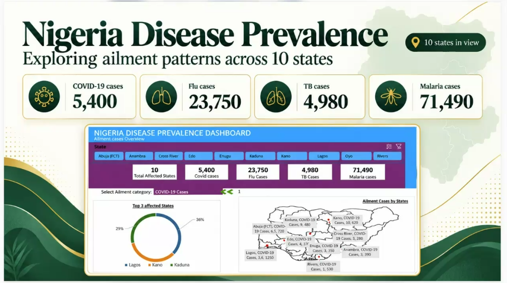

# Nigeria Disease Prevalence Dashboard: Key Insights from 10 States

> **Originally published on Medium** · Christian Iyayi · 21 October 2026
> Canonical link: <https://medium.com/@krisnice2002gmail.com/nigeria-disease-prevalence-dashboard-key-insights-from-10-states-c622920f527a>

*The Power BI dashboard behind this report: four disease KPIs, a state slicer, a top-three
breakdown and a state-level map.*

## Introduction

Data becomes valuable when it helps decision-makers understand where problems exist and where
resources should be focused. This Power BI dashboard provides an overview of disease prevalence
across ten Nigerian states, tracking cases of **Malaria, Flu, Tuberculosis (TB), and COVID-19**.

The analysis highlights both the overall disease burden and the geographic distribution of cases,
helping public health stakeholders identify priority areas for intervention.

## Overview of disease burden

Across the ten states included in the dashboard, recorded cases total:

- **71,490 Malaria cases**
- **23,750 Flu cases**
- **5,400 COVID-19 cases**
- **4,980 TB cases**

The data immediately reveals that **Malaria remains the most widespread health challenge**,
accounting for significantly more cases than all other diseases combined. This suggests that
malaria prevention and treatment programs continue to require substantial attention and investment.

While COVID-19, Flu, and TB remain important public health concerns, their prevalence is
considerably lower within the selected states.

## COVID-19 hotspots emerge

The dashboard focuses on COVID-19 cases, revealing clear regional differences in disease prevalence.

The three most affected states are:

- **Abuja (FCT): 6,500 cases**
- **Kaduna: 4,980 cases**
- **Lagos: 3,620 cases**

Together, these states account for most reported COVID-19 cases in the dataset. The visualization
shows Abuja contributing the largest share, followed closely by Lagos and Kaduna.

The higher case numbers in these locations may reflect factors such as population density,
urbanization, economic activity, and population movement, all of which can influence disease
transmission.

## Uneven disease distribution across states

Not all states experienced the same level of disease burden. Several states reported comparatively
lower COVID-19 cases:

- Rivers: 1,530 cases
- Cross River: 3,280 cases
- Enugu: 3,350 cases
- Anambra: 3,390 cases
- Edo: 4,370 cases

These variations demonstrate that disease prevalence is not evenly distributed across the country.
Understanding these geographical differences can help health authorities prioritize surveillance,
medical supplies, awareness campaigns, and healthcare funding where they are most needed.

## The value of geographic analysis

One of the dashboard's strongest features is its map visualization, which transforms raw numbers
into a clear geographic story. By displaying cases across states, decision-makers can quickly
identify hotspots and compare regional performance.

This type of visualization supports:

- Better resource allocation
- Faster identification of high-risk areas
- More targeted public health interventions
- Improved monitoring of disease trends

Rather than relying solely on summary statistics, stakeholders can use geographic insights to make
more informed and timely decisions.

## Conclusion

The dashboard demonstrates how Power BI can convert health data into actionable insights. While
malaria remains the dominant public health concern among the diseases analysed, COVID-19 cases show
notable concentrations in Abuja, Kaduna, and Lagos.

The findings reinforce the importance of targeted interventions rather than a one-size-fits-all
approach. By understanding where disease burdens are highest, healthcare agencies can allocate
resources more effectively, improve response strategies, and ultimately achieve better public health
outcomes.

**Key takeaway:** Effective healthcare planning depends not only on knowing how many cases exist, but
also on understanding where those cases occur and which diseases place the greatest burden on
communities.

---

### Editorial note for this repository

The figures above are reproduced exactly as published. Where the article narrative and the dashboard
visualization disagree — most visibly for Kaduna, and for Kano which the narrative does not mention —
this repository keeps both readings and documents the discrepancy in
[`data_notes.md`](data_notes.md). Charts in [`../README.md`](../README.md) are rebuilt from the
curated tables in [`../data`](../data), not from the prose.

*Connect with the author on [LinkedIn](https://www.linkedin.com/in/christianiyayi/).*
